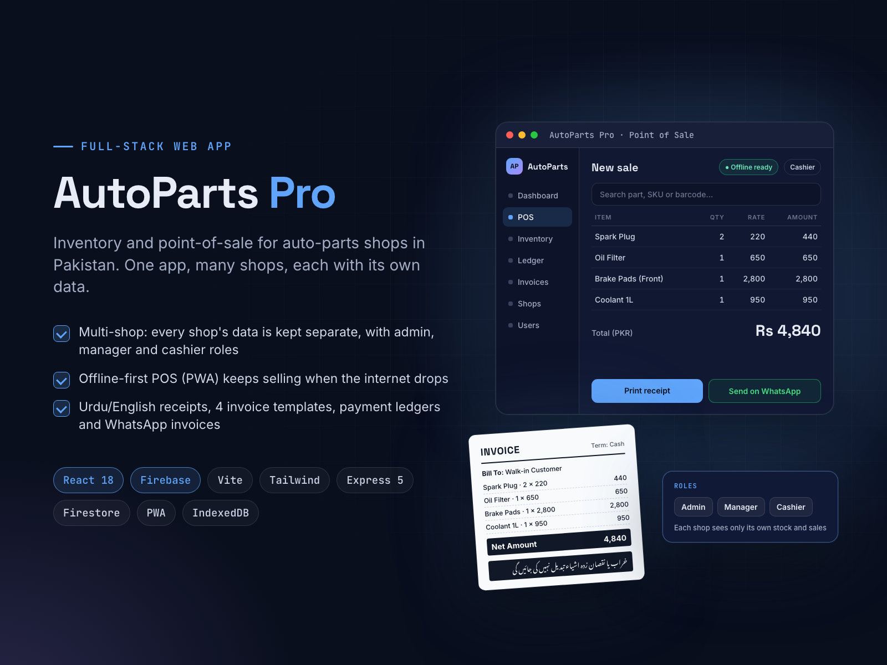

# AutoParts Pro

**Multi-Shop Inventory & POS Web App (React, Firebase)**

**Goal:** one simple system for auto-parts shops in Pakistan to manage stock, sales and customer credit.

**Solution:** a multi-tenant web app where each shop's data is kept separate, with admin, manager and cashier roles. The POS works offline as a PWA and syncs later. It has payment ledgers, bills and estimates with 4 print templates, Urdu/English receipts and WhatsApp invoices. Built with React 18, Vite, Tailwind, Express 5, Firebase Auth and Firestore.

**Result:** one codebase serves many shops, and billing keeps running when the internet drops.

| | |
|---|---|
| **My role** | Solo full-stack developer and product owner |
| **Skills** | React, Firebase, Node.js, Full-Stack Development, Web Application |

## About this repository

This is a showcase repository. It contains the project poster and the poster's own HTML/CSS source in [`poster/`](poster/).
The app's source code is kept private.

To re-render the poster, open `poster/index.html` in Chrome at 1600×1200, or run `poster/render.sh` on macOS.

More of my work: **https://ahsanrazapk.github.io**
